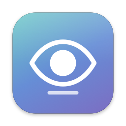

<p align="center">
  
</p>

<h1 align="center">Steady</h1>

<p align="center">
  A macOS menu bar app that notices focus habits through the built-in camera and gives a gentle nudge.<br>
  Everything runs on your Mac.
</p>

<p align="center">
  <a href="https://github.com/arrnav/steady-behave/actions/workflows/ci.yml"></a>
  
  <a href="LICENSE"></a>
  
  
  
  
  
</p>

Steady is a small macOS menu bar app that helps you stay focused while you study and work. It watches you through the MacBook's built-in camera and gives a gentle nudge (a screen flash, a soft sound and a trackpad tap) when it notices one of these habits:

- a stretched, tense smile or face you make without noticing while reading or thinking
- looking away from the screen during a study session
- fidgeting a lot, or touching your face, hair or beard

It can also save short clips of fidgety moments, so you can see later how you look to other people.

Most of these habits happen without you noticing, so the app does the noticing for you. The idea comes from habit reversal training: first become aware of a habit each time it happens, then replace it with a small, calm action. Everything is calibrated to your own face, so it learns what your habits look like.

## Privacy

Everything stays on your Mac.

- The app has no network code and makes no internet connections.
- It uses Apple's built-in Vision framework. No third-party models or services are involved.
- The camera turns off when monitoring is paused, the screen is locked or the Mac sleeps.
- All data (trained models, daily stats, clips) is stored in `~/Library/Application Support/Steady/`, readable only by your user account. It can be deleted from Settings at any time.
- Clips are ordinary video files, so other apps running under your account can read them, like any file in your home folder. Clips can be turned off in Settings.

## Requirements

- Apple Silicon Mac with macOS 14 or later
- Xcode or the Xcode Command Line Tools (`xcode-select --install`)
- A free Apple ID signed into Xcode is enough. No paid developer account is needed.

## Build and run

```bash
./build.sh            # builds build/Steady.app
./build.sh --run      # builds and opens it
./build.sh --install  # builds, copies to /Applications and opens it
./build.sh --selftest # builds and runs the built-in checks (no camera needed)
```

The build script signs the app with your "Apple Development" certificate if one is in your keychain. That keeps camera permission working across rebuilds. If there's no certificate, it signs ad-hoc, and macOS will ask for camera permission again after each rebuild.

## First run

1. Allow camera access when macOS asks.
2. From the menu bar icon, run **Calibrate Smile** (about 1 minute).
3. Run **Calibrate Gaze** (about 40 seconds).
4. Start a study session with **⌃⌥S**.

## Hotkeys

| Keys | Action |
|---|---|
| ⌃⌥S | Start or stop a study session |
| ⌃⌥X | False alarm (the last alert was a normal face; the app learns from it) |
| ⌃⌥M | Missed one (it's happening right now) |
| ⌃⌥D | Open debug mode |

## How detection works

- **Smile:** Vision face landmarks are turned into measurements such as mouth width, corner lift and eye openness. A small model trained on your own calibration data decides whether it's the stretched smile. The hotkeys above add new examples and retrain it.
- **Looking away:** head angle and pupil position, learned from a calibration where you follow a moving dot. Alerts are muted while you're typing or using the mouse.
- **Fidgeting:** overall movement compared with your calm level, head movement, and hands near your face (Vision hand pose).

## Choosing what to watch

Each of the four detections can be turned on or off on its own, from the menu bar icon under **Detections** or in **Settings > General**. A detection that is off gives no alerts, adds nothing to stats and saves no clips.

The glow color for each alert type can be changed in **Settings > Alerts**, along with its sound and trackpad tap.

## Battery use

The camera itself uses some power whenever it is on. To keep the rest low, **Settings > General > Camera > Quality** sets how many frames are analysed: High (15 a second), Balanced (10, the default) or Battery Saver (5). Battery Saver turns on by itself when the Mac is on battery or in Low Power Mode. When nobody is in view for 10 seconds, Steady only looks for a face, twice a second. Pausing, locking the screen or sleeping turns the camera off completely.

## Debug mode

Press ⌃⌥D to see what the app sees: face landmarks, head pose, gaze direction, hand and body skeletons, the hand-near-face zone, a motion heatmap, live classifier values with graphs, and a log of every detection and alert. Thresholds can be tuned live from the same window.

## Data and storage limits

- Clips: at most 1 every 3 minutes and 25 a day, a 500 MB total cap, and automatic deletion after 14 days. All limits can be changed in Settings.

## Uninstall

```bash
rm -rf /Applications/Steady.app
rm -rf ~/Library/Application\ Support/Steady
defaults delete com.arnav.steady
tccutil reset Camera com.arnav.steady
```

## Project layout

```
build.sh                    builds, signs and optionally runs or installs the app
Info.plist                  bundle settings and the camera usage text
Steady.entitlements         camera entitlement for the hardened runtime
scripts/make-icon.swift     draws the app icon at every size
Sources/
  main.swift                app start-up, camera on/off rules, hotkeys
  AppState.swift            settings and shared app state
  Engine.swift              runs detection on each camera frame and hands alerts to the UI
  CameraService.swift       AVCaptureSession, built-in camera by default
  VisionPipeline.swift      Vision requests per frame: face, landmarks, hands, body, motion
  FaceFeatures.swift        landmarks to smile and gaze measurements
  LogisticModel.swift       the small personal classifier and its storage
  EpisodeTracker.swift      hold time, cooldown and repeat rules shared by all alerts
  SmileDetector.swift       stretched smile
  AttentionDetector.swift   looking away
  ActivityDetector.swift    movement, head speed, upper body and hands near the face
  FocusContext.swift        study sessions, study apps, quiet mode during calls
  AlertCenter.swift         sound, screen glow, menu bar flash and haptic for each alert
  OverlayWindow.swift       the click-through edge glow on every screen
  Haptics.swift             trackpad taps through MultitouchSupport, with a fallback
  ClipRecorder.swift        rolling 10 s buffer, clip writing and storage limits
  StatsStore.swift          per-day counters
  HotKeys.swift             global hotkeys
  StatusBarController.swift the menu bar icon and menu
  WindowManager.swift       opening and remembering windows
  EventLog.swift            recent detections and alerts for debug mode
  SelfTest*.swift           checks run by ./build.sh --selftest
  Views/                    calibration, debug mode, clips, stats and settings windows
docs/
  DESIGN.md                 design notes and the reasons behind them
  TESTING.md                automated checks and a manual test plan
```

## Contributing

This started as a personal tool. Issues and pull requests are welcome, especially for better detection and support for more Macs. See [CONTRIBUTING.md](CONTRIBUTING.md). To report a security problem, see [SECURITY.md](SECURITY.md).

## License

MIT. See [LICENSE](LICENSE).

## Credits and references

- Build approach (plain `swiftc` and a build script, no Xcode project) based on [Posturr](https://github.com/tldev/posturr) and [Dorso](https://github.com/tldev/dorso)
- Gaze idea (head angle plus pupil position) from [EyeFocus](https://github.com/AquiGorka/eye-focus)
- Trackpad haptics through MultitouchSupport from [niw's MTActuator sample](https://gist.github.com/niw/b120b460e854ec10cefeeb60784f5dbb) and [mactic](https://github.com/MatMercer/mactic)
